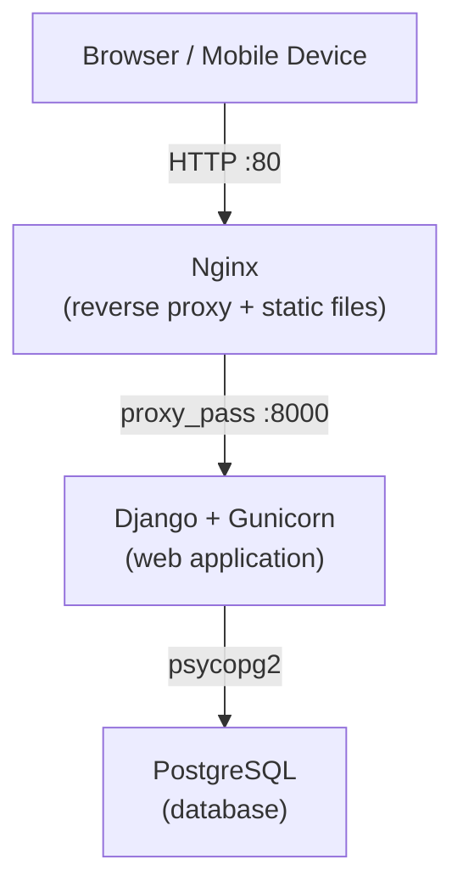

---
hide:
  - navigation
---

# Tech Stack

This page describes all tools and frameworks used in the KSP project.

---

## Backend

| Tool / Library | Version | Purpose |
|---|---|---|
| [Python](https://www.python.org/) | ≥ 3.12 | Primary programming language |
| [Django](https://www.djangoproject.com/) | 5.x | Web framework — routing, ORM, templating, auth, i18n |
| [Gunicorn](https://gunicorn.org/) | ≥ 23.0 | WSGI HTTP server for production deployments |
| [psycopg2-binary](https://www.psycopg.org/) | ≥ 2.9.10 | PostgreSQL database adapter for Python |
| [python-dotenv](https://pypi.org/project/python-dotenv/) | ≥ 1.0 | Loads environment variables from `.env` files |
| [django-widget-tweaks](https://pypi.org/project/django-widget-tweaks/) | ≥ 1.5 | Renders form fields with custom HTML attributes in templates |
| [Pillow](https://python-pillow.org/) | ≥ 10.0 | Image processing (e.g. logo, QR code images) |
| [qrcode](https://pypi.org/project/qrcode/) | ≥ 7.0 | QR code generation for shelf labels |
| [XlsxWriter](https://xlsxwriter.readthedocs.io/) | ≥ 3.0 | Excel (.xlsx) export for inventory reports |
| [ReportLab](https://www.reportlab.com/) | ≥ 4.0 | PDF generation |
| [polib](https://pypi.org/project/polib/) | ≥ 1.2 | Reading/writing PO/MO translation files |

---

## Database

| Tool | Version | Purpose |
|---|---|---|
| [PostgreSQL](https://www.postgresql.org/) | 15 | Primary relational database |

---

## Web Server & Infrastructure

| Tool | Purpose |
|---|---|
| [Nginx](https://nginx.org/) | Reverse proxy, static file serving, HTTP routing |
| [Docker](https://www.docker.com/) | Container runtime for application and services |
| [Docker Compose](https://docs.docker.com/compose/) | Multi-container orchestration (web, db, nginx) |

---

## Frontend

| Tool / Library | Version | Purpose |
|---|---|---|
| [Django Templates](https://docs.djangoproject.com/en/stable/topics/templates/) | — | Server-side HTML rendering |
| [Bootstrap](https://getbootstrap.com/) | 5.3 | Responsive CSS/JS UI framework |
| [Font Awesome](https://fontawesome.com/) | 6.0 | Icon library |
| [Select2](https://select2.org/) | 4.1 | Enhanced `<select>` dropdowns with search |
| [jQuery](https://jquery.com/) | 3.6 | JavaScript utility library |
| [jQuery UI](https://jqueryui.com/) | 1.13 | UI widgets (e.g. autocomplete, date picker) |

---

## Development Tools

| Tool | Version | Purpose |
|---|---|---|
| [uv](https://docs.astral.sh/uv/) | latest | Python package and virtual environment manager |
| [Ruff](https://docs.astral.sh/ruff/) | ≥ 0.11.9 | Python linter and code formatter |
| [GNU gettext](https://www.gnu.org/software/gettext/) | — | Generates `.po`/`.mo` translation files |

---

## Documentation

| Tool | Version | Purpose |
|---|---|---|
| [MkDocs](https://www.mkdocs.org/) | ≥ 1.6.1 | Static documentation site generator |
| [MkDocs Material theme](https://squidfunk.github.io/mkdocs-material/) | ≥ 9.6.14 | Documentation theme with dark/light mode, search, i18n |
| [mkdocs-mermaid2-plugin](https://github.com/fralau/mkdocs_mermaid2_plugin) | ≥ 1.2.1 | Renders Mermaid diagrams (e.g. ER diagrams) in docs |

---

## Architecture Overview

