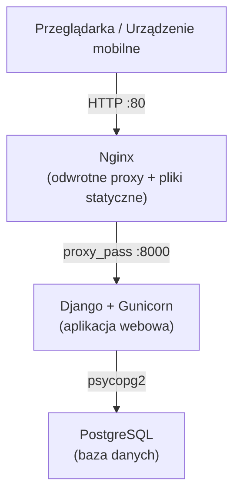

---
hide:
  - navigation
---

# Stos Technologiczny

Na tej stronie opisano wszystkie narzędzia i frameworki wykorzystywane w projekcie KSP.

---

## Backend

| Narzędzie / Biblioteka | Wersja | Zastosowanie |
|---|---|---|
| [Python](https://www.python.org/) | ≥ 3.12 | Główny język programowania |
| [Django](https://www.djangoproject.com/) | 5.x | Framework webowy — routing, ORM, szablony, autoryzacja, i18n |
| [Gunicorn](https://gunicorn.org/) | ≥ 23.0 | Serwer HTTP WSGI do wdrożeń produkcyjnych |
| [psycopg2-binary](https://www.psycopg.org/) | ≥ 2.9.10 | Adapter bazy danych PostgreSQL dla Pythona |
| [python-dotenv](https://pypi.org/project/python-dotenv/) | ≥ 1.0 | Ładowanie zmiennych środowiskowych z pliku `.env` |
| [django-widget-tweaks](https://pypi.org/project/django-widget-tweaks/) | ≥ 1.5 | Renderowanie pól formularzy z niestandardowymi atrybutami HTML w szablonach |
| [Pillow](https://python-pillow.org/) | ≥ 10.0 | Przetwarzanie obrazów (np. logo, obrazy kodów QR) |
| [qrcode](https://pypi.org/project/qrcode/) | ≥ 7.0 | Generowanie kodów QR dla etykiet półek |
| [XlsxWriter](https://xlsxwriter.readthedocs.io/) | ≥ 3.0 | Eksport do pliku Excel (.xlsx) dla raportów magazynowych |
| [ReportLab](https://www.reportlab.com/) | ≥ 4.0 | Generowanie plików PDF |
| [polib](https://pypi.org/project/polib/) | ≥ 1.2 | Odczyt i zapis plików tłumaczeń PO/MO |

---

## Baza danych

| Narzędzie | Wersja | Zastosowanie |
|---|---|---|
| [PostgreSQL](https://www.postgresql.org/) | 15 | Główna relacyjna baza danych |

---

## Serwer WWW i infrastruktura

| Narzędzie | Zastosowanie |
|---|---|
| [Nginx](https://nginx.org/) | Odwrotne proxy, serwowanie plików statycznych, routing HTTP |
| [Docker](https://www.docker.com/) | Środowisko kontenerowe dla aplikacji i usług |
| [Docker Compose](https://docs.docker.com/compose/) | Orkiestracja wielu kontenerów (web, db, nginx) |

---

## Frontend

| Narzędzie / Biblioteka | Wersja | Zastosowanie |
|---|---|---|
| [Django Templates](https://docs.djangoproject.com/en/stable/topics/templates/) | — | Renderowanie HTML po stronie serwera |
| [Bootstrap](https://getbootstrap.com/) | 5.3 | Responsywny framework CSS/JS |
| [Font Awesome](https://fontawesome.com/) | 6.0 | Biblioteka ikon |
| [Select2](https://select2.org/) | 4.1 | Rozszerzone listy rozwijane z wyszukiwaniem |
| [jQuery](https://jquery.com/) | 3.6 | Biblioteka narzędziowa JavaScript |
| [jQuery UI](https://jqueryui.com/) | 1.13 | Widżety UI (np. autouzupełnianie, wybór daty) |

---

## Narzędzia deweloperskie

| Narzędzie | Wersja | Zastosowanie |
|---|---|---|
| [uv](https://docs.astral.sh/uv/) | najnowsza | Menedżer pakietów i środowisk wirtualnych dla Pythona |
| [Ruff](https://docs.astral.sh/ruff/) | ≥ 0.11.9 | Linter i formatter kodu Python |
| [GNU gettext](https://www.gnu.org/software/gettext/) | — | Generowanie plików tłumaczeń `.po`/`.mo` |

---

## Dokumentacja

| Narzędzie | Wersja | Zastosowanie |
|---|---|---|
| [MkDocs](https://www.mkdocs.org/) | ≥ 1.6.1 | Generator statycznych stron dokumentacji |
| [Motyw Material dla MkDocs](https://squidfunk.github.io/mkdocs-material/) | ≥ 9.6.14 | Motyw dokumentacji z trybem ciemnym/jasnym, wyszukiwarką i i18n |
| [mkdocs-mermaid2-plugin](https://github.com/fralau/mkdocs_mermaid2_plugin) | ≥ 1.2.1 | Renderowanie diagramów Mermaid (np. diagramy ER) w dokumentacji |

---

## Przegląd architektury

